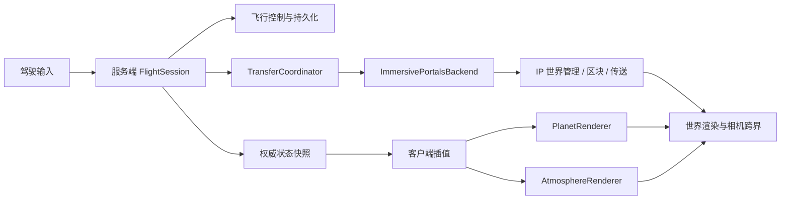

# 架构决策：IP 后端与专用星球渲染

状态：已选定开发路线，尚未通过运行阶段门。日期：2026-11-23。

## 1. 选择

采用 **锁定 IP Forge 3.0.7 的跨维度后端，ROCKET 自研火箭飞行和行星视觉**。

| 方案 | 结论 | 原因 |
| --- | --- | --- |
| IP 后端 + 专用飞行与渲染 | 采用 | 当前已依赖，具备多世界、区块同步、相机跨界基础，可尽早实验验证 |
| 原版 changeDimension + 淡出合成 | 仅作为调试能力 | 原版迁移与全屏混合本身不提供远端世界实时可见和相机连续 |
| 从零实现多世界 Portal Engine | 后续独立项目 | 涉及 ClientLevel、LevelRenderer、包路由、实体追踪、预测和资源生命周期 |
| 直接依赖/移植 Voxy | 不采用 | 与当前 Forge 1.20.1 工程不匹配；只研究 LOD 思想 |

本路线调整了先前建议中的“不依赖 IP”：第一版使用锁定版本的 IP 后端，并以 G0/G1 实验作为继续开发的前置门槛；业务代码通过适配器隔离其 API。若将来移除 IP，必须逐项替代其运行职责并重新验收，不把移除依赖列为首版前置条件。出处见 [固定版本研究](02-immersive-portals-research.md)。

## 2. 首版范围

首版火箭为一个实体，包含推进、燃料和一个直接骑乘驾驶员。火箭可存在于多人服务器，但每艘先只支持一名驾驶员；多乘客、嵌套实体与无人驾驶跨界分别立项。

首版映射只做平移，速度上限由 G1 实验确定。先在有限水平门户与受控发射走廊验证；通过后再研究覆盖天空的全局水平连接。门户存在范围和加载区块范围分别管理。

星球首先是视觉代理：局部表面来自已加载主世界的采样，未知区域使用程序化低精度外观。不能承诺球面每个位置都对应真实已生成主世界，也不提供透过代理交互远端方块的语义。

## 3. 系统职责



只有 `compat/immptl/` 允许引用 IP 类型。该层分客户端/服务端实现，COMMON 入口不得加载 `net.minecraft.client`。初期只实现一个后端，保持小接口，不预建通用插件框架。

建议后续目录在现有包下逐步增加：

```text
com/example/examplemod/
  flight/          FlightSession, FlightPhase, FlightController
  rocket/          RocketEntity, RocketState
  transition/      TransferCoordinator, TransferSnapshot, CoordinateMapper
  network/         FlightInput, FlightSnapshot, TransitionPrepare, TransitionReady
  compat/immptl/   ImmersivePortalsBackend, ChunkLease
  client/render/   PlanetRenderer, AtmosphereRenderer, TransitionComposite
  client/camera/   RocketCameraController
```

资源 shader 应放在 `src/main/resources/assets/rocketmod/shaders/`，不放入 Java 包目录。包名整理可后续做，保留 `rocketmod`、`rocketmod:space` 等已有注册标识。

## 4. 高度与坐标

定义三个不同量：物理位置 `P`、连续飞行高度 `H`、视觉星球半径 `R`。R 只参与视觉投影，不改变实体距离或时间步长。

第一版沿用现有边界参数：主世界 `H_up=512`，太空对应平面 `Y_entry=64`，坐标缩放 1、朝向不旋转。

```text
source -> space: (x, y, z) -> (x, y - 512 + 64, z)
space -> source: (x, y, z) -> (x, y + 512 - 64, z)
source 中 H = y
space 中 H = 512 + (y - 64)
v_space = v_source
```

保存发射地点只用于航线/星球局部投影，不擅自令太空 x/z 归零。这样不同发射点不会误落入同一物理位置。所有端点使用同一份服务端映射配置和版本号。

跨越前后 H 连续；同一变换作用于当前/上一 tick 位置、上一帧相机、速度和姿态。新实体仍以 UUID 解析；`restoreFrom` 后不能继续使用旧 Java 引用。空间不足应限制航线或显式重定位；禁止用 clamp 静默丢弃真实高度。

以后若引入旋转/缩放，位置、速度、相机方向、碰撞尺度必须成套定义，并测试往返逆变换。全局无限平坦世界无法无损一一映射到有限球面，首版限定发射区域的切平面映射和近地视觉一致。

## 5. 两个状态机

飞行状态表达玩法：

```text
GROUND -> LIFTOFF -> LOWER_ATMOSPHERE -> UPPER_ATMOSPHERE -> SPACE
SPACE -> REENTRY -> DESCENT -> GROUND
```

转移状态表达生命周期，独立于飞行阶段：

```text
IDLE -> PREPARING -> READY -> CROSSING -> CONFIRMED -> CLEANUP
PREPARING -> ABORTED -> CLEANUP
CROSSING -> RECOVERING -> CONFIRMED/CLEANUP
```

`TransferCoordinator` 管理准备、验证和恢复，**不与 IP 自然门户传送同时执行第二次手工传送**。正常穿越由 IP 负责；原有高度 tick API 在正式飞行模式必须禁用或限制为独立调试路径。

首版先验证单驾驶员直接骑乘的 IP 自然穿越，不预先 eject 全体乘客再逐个迁移。若该路径不能通过 G2，就暂停扩展，定位最小适配问题；复杂乘客迁移需独立快照与状态恢复协议。

实际跨界以门户平面与运动线段相交为准。冷却和方向锁只阻止重复请求，不通过改写逆向映射破坏几何连续；客户端相机预测、服务端判断必须使用一致规则。

## 6. 预热与网络

1. 服务端创建 `transitionId`，记录 rocket UUID、驾驶员、来源/目标维度、映射版本和开始 tick。
2. 后端申请有限半径目标 ChunkLoader，保留其对象用于释放。客户端收到 Prepare 和权威参数。
3. 客户端检查目标 ClientLevel、所需区块、必要实体和可见网格；通过实际首次可绘制帧观测后发送 Ready。空区块可被标记为已知为空，不等待不存在的 mesh。
4. 服务端检查会话、连接、载具和目标碰撞/票据，再开放该会话的穿越资格。Ready 只反映客户端准备，不能授权修改坐标或燃料。
5. 未准备好时在安全距离制动/悬停；制动距离按 `v^2/(2a)` 加网络提前量计算，不能到边界一帧才刹停。初始准备超时预算为 10 秒，作为可调整实验值。
6. 穿越后两端确认维度、UUID、驾驶员挂载和 H。确认窗口后释放旧世界租约；死亡、断线、取消、卸载与超时均需释放。

IP 没有为本项目提供现成的“所有目标 GPU mesh 已就绪”回调。G3 必须先找到可观测接口/最小 Mixin；没有证据前不能把服务端发送区块等同于画面就绪。

消息至少带协议版本、会话 ID、单调 sequence。驾驶输入有限频率，服务端检查座位权限、范围和速率；客户端只插值。配置由服务端下发，不能让渲染读取各自不同的 COMMON 配置决定边界。

`TransferSnapshot` 记录实体 UUID、飞行状态、位置/速度/姿态、燃料、驾驶员和目标。跨界后失败先检查两世界现存实体，按 UUID 去重并恢复；不能盲目重建造成复制。跨实体的维度迁移没有数据库式原子事务保证，崩溃恢复必须在 G2/G6 另测。

## 7. 渲染路线

近地使用真实区块。随 H 上升渐进引入与发射地对齐的曲面局部代理，再过渡到完整球体代理；靠近地表逐步反向恢复。初版 CPU 生成有限细分 Cube Sphere 或局部 patch，使用普通顶点缓冲和 GLSL，不要求 Compute Shader/间接绘制。

大气权重由服务端状态经客户端插值计算；Java 17 使用 `Mth.clamp` 或 `Math.max/min`，不能直接使用较新 JDK 的 `Math.clamp`。

```java
static float smoothRange(double h, double start, double end) {
    if (end <= start) throw new IllegalArgumentException("Invalid altitude range");
    double t = Math.max(0.0, Math.min(1.0, (h - start) / (end - start)));
    return (float) (t * t * (3.0 - 2.0 * t));
}
```

示例区间只驱动视觉，不定义传送：大气稀薄 128..512，曲面代理引入 256..768。真实区块的替换范围必须与代理覆盖范围一致，不能全屏淡出后露出未定义表面。

渲染分为世界 pass 与最终画面 pass：

| 时机 | 工作 |
| --- | --- |
| 各维度世界 pass | 自身天空、行星深度与几何；遵循 IP clipping 和相机上下文 |
| IP 目标世界 pass | IP 管理远端世界、透明物体次序和门户深度 |
| 主画面最终合成 | 单次大气/曝光效果，正确处理船舱遮挡和深度 |
| 末尾 | 第一人称手部/驾驶舱与 HUD 按设计顺序绘制，不重复绘制 IP 已处理的火箭 |

先使用 IP 已有渲染后端。只在需要混合独立视觉图层时增加 FBO，并同步深度语义；FBO 不代替 ClientLevel/网络。光照、雾、云、星空、粒子与大气各有单一责任，避免多次叠加。以明确的主视图上下文判定最终 pass，不能只靠容易嵌套失效的全局 boolean。

大气最终可升级 Rayleigh/Mie 模型，先通过低成本颜色/消光原型验证顺序。所有 viewport、FBO、depth/stencil、blend、camera 状态在 `try/finally` 或等价作用域恢复；支持窗口缩放、F3+T 和退出世界。

## 8. 后续扩展条件

G1/G2 不通过时优先修复已定位的版本适配；只有确需修改 IP 内部时才做最小补丁并保留来源/许可。若改为独立后端，必须新建 ADR 和原型，覆盖世界管理、包路由、跟踪和相机四项。

Cube Sphere 分块与 LOD 在视觉闭环后引入。仅采样已经加载或已持久化的数据，后台工作线程只处理线程安全快照；不因看到完整球体就生成全地图。缓存按世界/维度/采样版本区分，设置更新预算与卸载清理。
