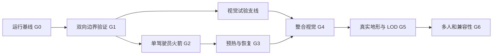

# 开发路线与验收

日期：2026-11-23。所有任务初始为待实施；本次文档交付不代表任何阶段已验收。

## 1. 里程碑与依赖

可以在 G1 通过后并行做独立视觉原型，但正式视觉闭环必须等待 G2/G3。把“能显示球体”和“能无缝驾驶跨维度”分别验收。

| 阶段 | 交付 | 依赖 | 通过条件 |
| --- | --- | --- | --- |
| G0 | 可复现构建、开发/发布运行基线 | 无 | 构建成功；开发客户端、发布客户端、专用服务器加载自定义维度 |
| G1 | 有限水平双向门户与 512→64 实验 | G0 | 玩家往返、坐标/相机连续，确认 IP 版本可用 |
| G2 | 一实体、单驾驶员最小火箭 | G1 | 燃料、UUID、速度、姿态、输入、骑乘完整往返 |
| G3 | 有预算的预热与转移协调器 | G2 | 未就绪安全悬停；断线/失败恢复；无票据和实体泄漏 |
| G4 | 大气、曲面代理、太空背景整合 | G3 + 视觉试验 | 正反向过渡无空白、无明显地表跳变、无重复后处理 |
| G5 | 局部真实地形、分块 Cube Sphere LOD | G4 | 已探索区域与地表对齐；未知区域降级；受限更新预算 |
| G6 | 并发、多乘客/无人驾驶、渲染兼容 | G5 | 每种新增能力独立通过状态一致性与压力测试 |

不按日期强行推进阶段。G1 或 G2 失败时暂停依赖该能力的扩展；保留可复现场景，决定适配、最小补丁或改写后端。

## 2. G0：建立真实运行基线

- [ ] 保存当前工程基线，准备 `.gitignore` 和首个提交候选；不把存档、缓存、日志、构建产物或 MDK zip 混入源码提交。
- [ ] 核对并固定工具链、Gradle 插件解析版本、Forge/IP/Cloth 版本及 jar 校验信息。
- [ ] Java 路径和代理改为本机可覆盖配置，测试代理开/关环境；依赖未缓存时明确记录网络失败原因。
- [ ] 检查 `processResources` 输出和最终发行 jar：mod id/version、维度 JSON、强制依赖、重映射产物正确。
- [ ] 开发客户端新建测试世界并进入太空；发布 jar 在普通 Forge 客户端另测。
- [ ] 专用服务器启动且无客户端类加载错误；客户端连接并识别 `rocketmod:space`。

证据：构建日志、版本清单、最终 jar SHA-256、客户端/服务器日志、测试存档名。不要把历史 11-17 日志记为本阶段通过。

## 3. G1：最先做的跨维度技术验证

实现仅供开发使用的独立测试入口和 `ImmersivePortalsBackend`。现有高度扫描会干扰门户自然跨越，进入测试模式时必须停用该自动扫描，保留显式管理员命令。

- [ ] 普通有限水平门户：先测试低空平面，再移动到主世界 Y=512 对应太空 Y=64。
- [ ] 显式配置门户朝向与反向连接；保持单位缩放和相同 x/z。
- [ ] 测试步行/创造飞行跨界；记录上升和下降穿越。
- [ ] 用可控的原版坐骑验证直接骑乘路径，记录模型尺寸和跨平面相机行为；它只能降低风险，不能替代自定义火箭验收。
- [ ] 扫描低/中/高速度及低帧率，区分玩家驱动路径与普通实体路径。
- [ ] 启动、停止、重进世界后连接数量稳定，能显式清理，不重复创建。

验收：至少连续 20 次双向跨越，没有加载界面、卡死、错误维度、重复传送或实体重复。逐帧检查眼睛位置/朝向；打印 source/target、position、velocity、UUID 和帧/tick 序号。仅靠无加载屏不算通过。

全局门户是 G1 的后续实验项，不阻塞有限航道首版；若 Y=512 在建造高度之外有渲染/碰撞问题，先保留可用低空实验，记录约束后调整映射，禁止把未测能力写成已解决。

## 4. G2：最小可驾驶火箭

- [ ] 注册单个 RocketEntity；最简可辨识模型和驾驶座，不先开发多方块火箭。
- [ ] 服务端处理油门/转向，燃料和推力可观测；设定经过 G1 验证的速度范围。
- [ ] 增加 FlightSession、飞行阶段与双向坐标映射；对往返映射和高度连续做确定性测试。
- [ ] NBT 保存 UUID 关联、燃料、飞行阶段、必要姿态与会话恢复信息；区分持久字段与临时网络序号。
- [ ] 采用 IP 自然门户路径，验证新维度实例与直接驾驶员挂载；不对旧实体引用继续施加输入。
- [ ] 测试跨界前后存档、重启、下车、死亡、断线后重连。

验收：20 次往返后实体数正确、燃料账实一致、驾驶员仍在座位、运动方向与飞行高度连续。单位平移的变换函数往返误差目标小于 `1e-6`；运行速度/姿态误差需扣除正常 tick 积分并记录，不用静态数学误差代替网络实测。

恢复原则：实际位置和现存 UUID 优先于旧事务标志。若穿越后客户端断线，重连后只能恢复一艘火箭和一个驾驶员关系，不能重复生成。复杂多人乘客树还不进入此阶段。

## 5. G3：预热、Ready 和故障恢复

- [ ] 封装 ChunkLease，默认实验半径 2 chunks，同时限制准备会话数。
- [ ] 增加 Prepare/Ready/Confirmed/Abort 消息，服务端下发阈值、映射和协议版本。
- [ ] 确定该版本客户端区块、实体、mesh 的就绪观测点；必要的最小 Mixin 单独列出并验证发行重映射。
- [ ] 根据速度、减速度、RTT 提前准备，未 Ready 安全制动；区分合法空区块与待编译网格。
- [ ] 设置准备超时、取消、死亡、断线、退出世界和服务器停止的租约清理。
- [ ] 处理穿越后不确认：按两世界 UUID 查实状态，转入恢复流程，防止重复迁移。

验收：人为延迟加载/Ready、丢弃或重复消息，火箭仍在安全区域；重放旧 transitionId 不生效。测试 150ms RTT / 50ms 抖动场景并记录环境，此为验收输入而非性能承诺。100 次准备/取消及 20 次往返后，附加 loader、会话和实体数量回到预期。

准备超时默认实验值 10 秒；确认后保留旧世界视野的时长由实际镜头需要决定并设置上限。服务端不会因 Ready 消息接受任意目标维度/坐标。

## 6. 视觉试验与 G4：形成可见的升空体验

G1 通过后可做无火箭物理依赖的高度滑动调试视图，专测三个视觉状态：地面真实区块、近地曲面、太空完整球体。

- [ ] 使用与发射地点一致的局部 patch；先程序化配色验证几何、相机和地平线，再接真实地形数据。
- [ ] 高度驱动天空/雾/云/星空和大气权重；服务端同步参数，客户端插值。
- [ ] 明确真实区块与代理重叠区域的深度与遮挡；避免两份地面同时可见。
- [ ] 先复用 IP renderer；只有独立图层合成确有需要才增加 FBO。
- [ ] 使用主视图最终 pass 合成大气；验证进入门户目标 pass 时不会重复后处理。
- [ ] 跨界前后保持同一 H 和视觉参数，下降反向恢复。
- [ ] 测试透明座舱、实体/手部/HUD、窗口缩放、F3+T、退出/重进世界。

验收：固定航线录制正反向录像，并保存跨界前后逐帧截图；不出现黑/白/空白帧、重复星球、明显地表尺度突变或驾驶舱错误雾化。静态帧和 motion 测试都要做。

## 7. G5：真实地形到球面的数据路线

1. 主线程从已加载区块取得高度/颜色等不可变采样快照，先保存低分辨率局部色图与高度图。
2. 后台处理快照，生成固定预算 patch 与缓存，结果回渲染线程上传 GPU。
3. 用切平面局部地形匹配发射点；远端过渡到 Cube Sphere 的六面分块。
4. 选择细节级别时设置误差阈值和滞回，避免边界抖动与裂缝。
5. 未采样区域使用低精度表面；世界/维度/区域/版本作为缓存键，修改地形只增量失效。

验收：改变已探索区域地形后局部更新正确；缓存损坏可重建；没有因全球展示而额外生成主世界全图。记录采样耗时、上传字节数、三角形数和缓存上限。

## 8. G6：并发与扩展

| 扩展项 | 新增验收 |
| --- | --- |
| 多个单驾驶员火箭 | 不同发射点与同时跨越，状态/租约/落点不串线 |
| 单火箭多乘客 | 全乘客树快照、玩家分别确认、部分断线、恢复去重 |
| 无人驾驶火箭 | IP 普通实体路径、速度限制和区块保持，不沿用玩家测试结论 |
| 全局天空连接 | 普通玩家/其他实体资格、目标视野加载成本、多个观测点 |
| 渲染模组 | 每个 Forge 1.20.1 具体版本单测；Shader、MSAA、FBO、透明物体和资源重载 |
| 更多天体/轨道 | 新映射、重力参考系、落点与存档迁移，另立设计决策 |

先通过原生 Forge + IP 的基线，再逐个加入优化/光影模组。不将 Fabric 上游兼容结论套用到 Forge 分支。

## 9. 共用性能与正确性门槛

以下是初始预算，需在 G0 记录 CPU/GPU/RAM、分辨率、视距、模拟距离和模组版本后测量：

| 指标 | 初始目标/检查方式 |
| --- | --- |
| 服务端稳定性 | 固定场景中平均 MSPT 小于 50ms，并记录 p95 与跨界尖峰 |
| 单次边界额外帧耗时 | 对比同场景 IP 基线，初始目标 p95 增量不超过 8ms；实测后调整 |
| 准备时延 | 记录冷/热区块、不同 RTT 的 p50/p95，不用无限等待换取成功 |
| 资源生命周期 | 往返、取消、断线后 loader/会话数归位，GPU 资源和内存无持续增长 |
| 数据连续 | UUID、实体数、维度、乘客、燃料、H、速度、姿态全记录 |

帧时间预算是开发目标，尚无本项目测量结果。不要承诺所有硬件固定 60 FPS，也不要把单机通过当成专用服务器或高延迟通过。

## 10. 第一批可执行任务

1. G0：记录环境和现有输出，处理 Java/代理配置，准备发行客户端与专用服务器基线。
2. G1：增加隔离测试模式与最小 IP backend，创建有限双向水平门户；先不写复杂 Shader。
3. G1：完成玩家往返和 512→64 的坐标/相机录像与数据采集，确定可用速度范围。
4. G2：实现一个最小火箭与单座驾驶，验证自然门户迁移及持久状态。
5. G3：加入目标预热和 Ready 协议，再合入视觉试验。

下一次代码开发应从第 1 项开始。独立 `RocketTransitionRenderer` 可以作为 G1 之后的视觉试验，但其成功不作为跨维度路线的可行性证明。
